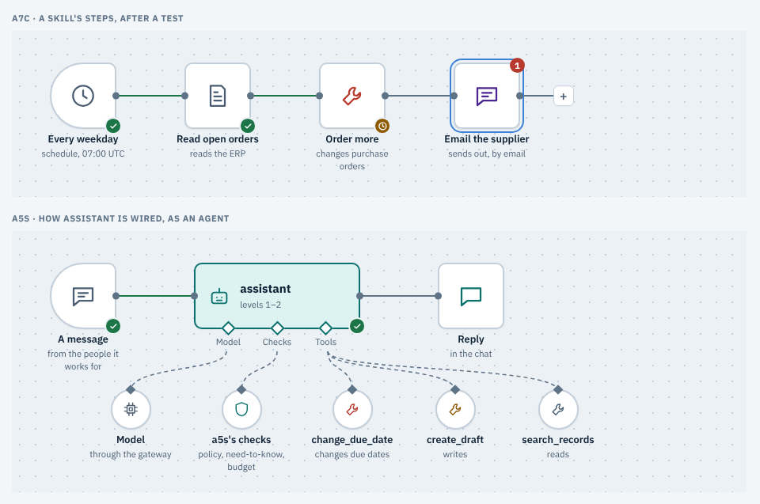
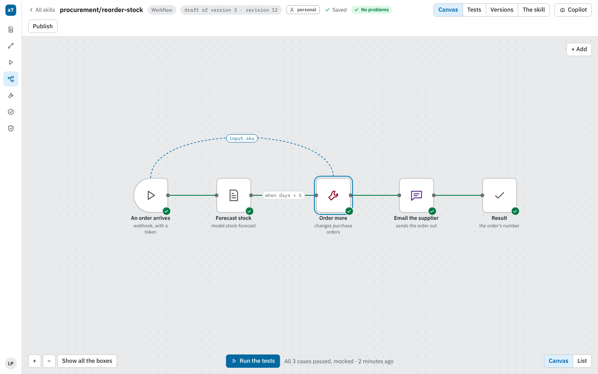
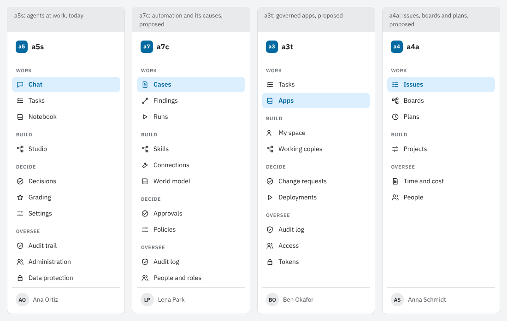
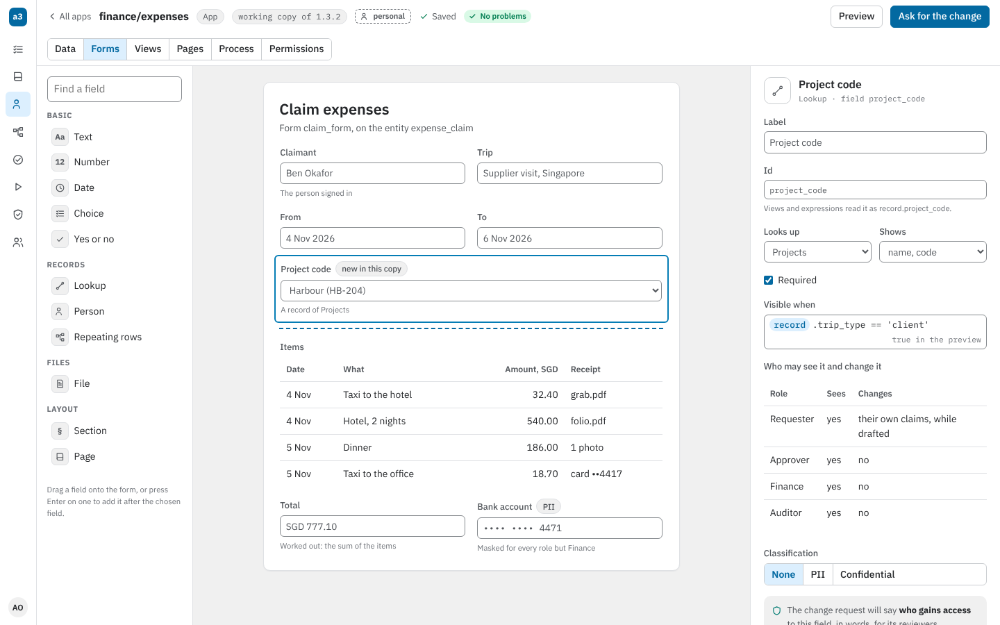
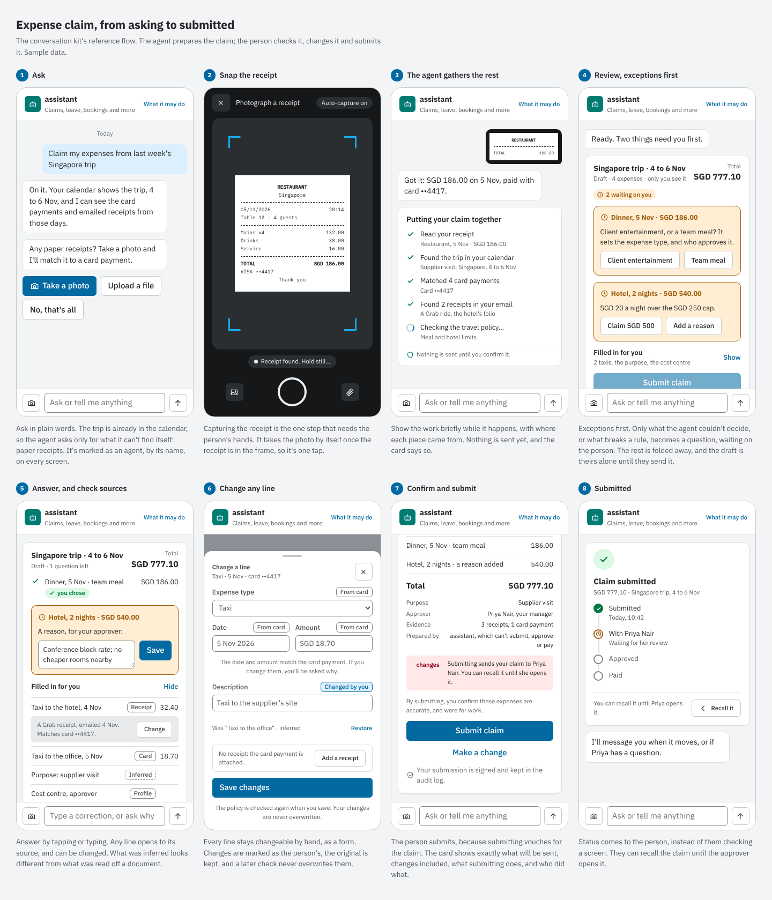
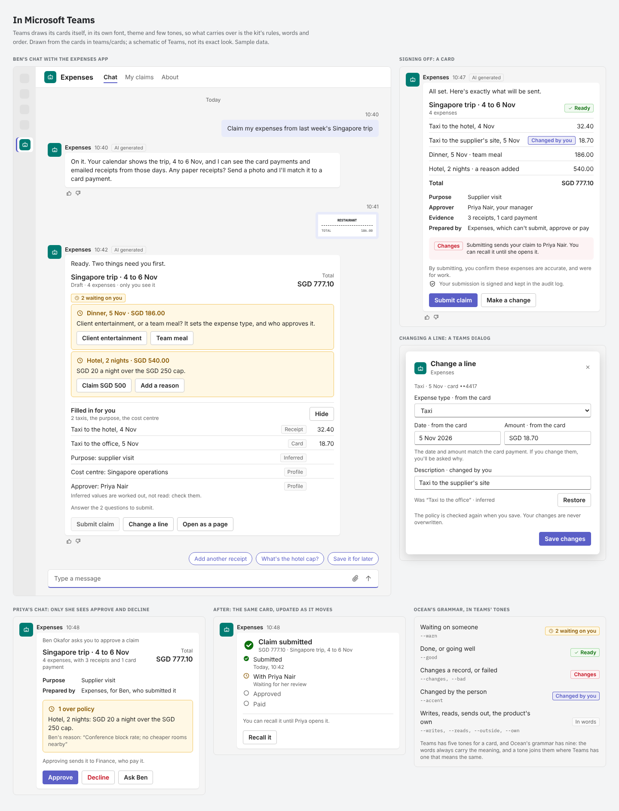

# Ocean

Ocean is the look a5s, a7c, a3t and a4a share: calm, with colour only where it means something, so a page makes plain what an agent or an automation may do, what it did, and who decides. It began in [a5s](https://github.com/sreent/a5s), and this repo is now its one source. It includes the conversation kit, for outcomes people ask for in a conversation, in the products' own apps and in Microsoft Teams.



## What's here

| Path | What |
| --- | --- |
| [`css/tokens.css`](css/tokens.css) | The tokens in two layers: the primitives (palette, type, spacing, radii), which a brand changes, and the meanings (what each colour is for, in light and dark), which everything else names |
| [`css/components.css`](css/components.css) | The pieces' look: the frame, controls, badges, a decision, an agent's facts, the ladder of autonomy, a run as time, the canvas and the workbench, the conversation kit, and a4a's issues, boards and plans |
| [`css/charts.css`](css/charts.css) | The chart colours: eight series and Other, Ocean Blue, Ocean Orange-Blue, and how runs end, in light and dark |
| [`fonts/`](fonts) | IBM Plex Sans (400 to 700), Plex Sans Thai (400 to 700) and Plex Mono (400, 500), with their licences |
| [`icons/`](icons) | The 36 line icons, on a 24-unit square, in `currentColor` |
| [`charts/palettes.json`](charts/palettes.json) | The chart palettes as data, for tools that can't read CSS |
| [`tokens.json`](tokens.json) | The tokens as data, built from `css/tokens.css`, for tools such as a Tailwind theme |
| [`components/`](components) | Each piece: what it's for, what it takes, and a preview of it as pages draw it; and showcase pages of the products |
| [`teams/`](teams) | The conversation kit's cards for Microsoft Teams, as Adaptive Card JSON, and what Teams decides rather than Ocean |
| [`docs/design.md`](docs/design.md) | The brand book: voice, colour and its grammar, type, layout, icons, and what it's held to |
| [`docs/products.md`](docs/products.md) | Across a5s, a7c, a3t and a4a: the same words, the same look, and what each product changes |
| [`docs/platforms.md`](docs/platforms.md) | Where people build, decide and use: the workbench, pages and the runtime, the kits each needs, and the plan for rebuilding Ocean here |
| [`docs/conversation.md`](docs/conversation.md) | The conversation kit, for outcomes rather than apps: its seven moments, its rules, what a capability gives it, its pieces, and how it works in Microsoft Teams |
| [`docs/images/`](docs/images) | How Ocean looks, drawn from the previews |
| [`scripts/check.mjs`](scripts/check.mjs) | The checks: contrast in light and dark, meanings that name only primitives, nothing loaded from outside, the chart palettes in step, and the Teams cards |
| [`scripts/build.mjs`](scripts/build.mjs) | The build: `tokens.json`, and the files of the design system on claude.ai |

## Using it

Load the two stylesheets, tokens first, and name meanings in your own styles:

```html
<link rel="stylesheet" href="ocean/css/tokens.css">
<link rel="stylesheet" href="ocean/css/components.css">
```

```css
.note { color: var(--muted); }
.held { background: var(--changes-bg); color: var(--changes); }
```

A page that draws charts loads `css/charts.css` after the tokens. In Microsoft Teams, Teams draws the cards itself, so a Teams app takes the conversation kit's cards from [`teams/cards`](teams/cards) instead of the stylesheets.

a5s serves the files itself, from a release. a7c, a3t and a4a take them as a dependency, pinned to a commit:

```json
"@sreent/ocean": "github:sreent/ocean#<commit>"
```

[`docs/products.md`](docs/products.md) says what each product changes, including a3t's Tailwind theme, which a4a's follows.

## Checking it

```bash
node scripts/check.mjs
```

A product that changes the brand checks its own tokens:

```bash
node node_modules/@sreent/ocean/scripts/check.mjs path/to/tokens.css
```

```bash
node scripts/build.mjs
```

The build writes `tokens.json`, and `dist/design-system/` for the Ocean design system on claude.ai.

## How it looks

Drawn from the previews in `components/`, in light. This is the design: no product draws all of it yet.







The last is Teams' look, not Ocean's: Teams draws its cards itself, in its own font and colours, so there the kit keeps Ocean's rules, words and order ([`docs/conversation.md`](docs/conversation.md)).

IBM Plex is © IBM Corp., under the SIL Open Font License 1.1 ([`fonts/`](fonts)).
